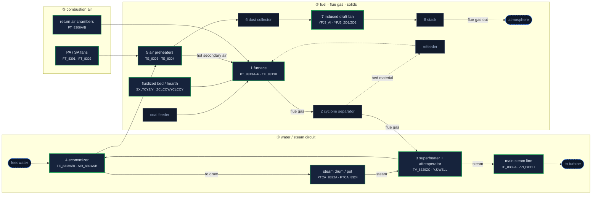

# Onboarding Knowledge — Boiler Diagram (source of truth)

> **Status: ADOPTED from the user's reference.** The user supplied
> `.agents/cfb_boiler.html` as the design to use; `templates/_boiler_svg.html`
> is now that cutaway (same geometry, palette, typography and 1–8 numbering),
> with live-value hooks added. The Mermaid source below remains the description
> of the process for documentation; the SVG is the rendered artefact.
>
> Changes made when adopting it: monitored groups carry
> `class="c-<circuit> part" data-part="<key>" tabindex="0"`, each has exactly one
> `.part-value` node, the furnace's internal gas arrow is classed `inner` (it
> terminates inside the vessel on purpose), and the situation level is applied
> as the **stroke** colour so the circuit fill is preserved.
>
> Final layout the user signed off on: the **live value sits with the part name**
> — on the name's line where the box is wide enough, and on its own line inside
> the box for the four narrow back-pass boxes (superheater, economizer, air
> preheaters; main steam kept it on the name line with a shorter label), with the
> return-air readout just outside because that box is narrowest of all.
> The schematic is **always dark** (light text on dark boxes; unmonitored
> equipment in dark grey `#262c38`), so text is legible regardless of the app
> theme. An injected fault gets the **blue accent outline** plus a pulse — the
> legend chip promised blue, so now the box actually turns blue,
> boxes are **filled by situation level** (nominal/watch/alert/critical, tinted
> via `fill-opacity` and pulsing when a fault is injected) instead of by
> circuit, the pipes keep their circuit colours, and there is **no legend inside
> the SVG** — the page's HTML legend carries both the level and pipe keys.
> Groups ship with `data-level="NOMINAL"` so boxes are tinted before the first
> poll.
>
> Two hard-won implementation rules:
> 1. **Readouts must not collide with headings.** `.part-value` is right-aligned
>    and sits *below* the box where the gap allows, *above* the two top-row
>    capsules, and *inside the lower-right corner* for the superheater and
>    economizer (only 16 px beneath them). `tests/test_diagram.py` fails if any
>    part's text lands inside another part.
> 2. **Never rely on the stylesheet alone for colour.** The boxes also carry
>    light-palette `fill`/`stroke` presentation attributes as a fallback: a
>    stale cached `app.css` once rendered the whole schematic as black boxes
>    with invisible text (unresolved `var()` falls back to `fill: black`).
>    Static assets are now cache-busted (`static_url()` adds `?v=<mtime>`) and
>    served with `no-cache`.

## What the diagram must show

- Three lanes: **water/steam circuit**, **fuel · flue gas · solids**, **combustion air**.
- The flue-gas sequence, numbered 1→8: furnace → cyclone separator →
  superheater → economizer → air preheater → dust collector → ID fan → stack.
- Steam side: steam drum → superheater (+ attemperator) → main steam line → turbine.
- Feedwater: economizer → steam drum.
- Air side: PA/SA fans → air preheater → hot secondary air into the furnace;
  return-air chambers flank the furnace.
- Solids: cyclone → refeeder → back into the furnace (circulating bed).
- Every **monitored** node carries its live value and is coloured by situation
  level (NOMINAL green → WATCH amber → ALERT orange → CRITICAL red).

## Mermaid source (canonical)

## Part keys ↔ diagram nodes ↔ tags

The diagram is generated from `config.py`; these are the stable identifiers the
UI relies on (`data-part` attributes in the SVG, keys in `/api/live` payloads).

| Part key | Node | Tags |
|---|---|---|
| `furnace` | 1 furnace | `PT_8313A–F.AV_0`, `TE_8313B.AV_0` |
| `fluidized_bed` | fluidized bed / hearth | `SXLTCYZ.AV_0`, `SXLTCYY.AV_0`, `ZCLCCY.AV_0`, `YCLCCY.AV_0` |
| `drum` | steam drum / pot | `PTCA_8322A.AV_0`, `PTCA_8324.AV_0` |
| `superheater` | 3 superheater + attemperator | `TV_8329ZC.AV_0`, `YJJWSLL.AV_0` |
| `main_steam` | main steam line | `TE_8332A.AV_0` (state tag), `ZZQBCHLL.AV_0` |
| `economizer` | 4 economizer | `TE_8319A.AV_0`, `TE_8319B.AV_0`, `AIR_8301A.AV_0`, `AIR_8301B.AV_0` |
| `air_preheaters` | 5 air preheaters | `TE_8303.AV_0`, `TE_8304.AV_0` |
| `combustion_fans` | PA / SA fans | `FT_8301.AV_0`, `FT_8302.AV_0` |
| `id_fan` | 7 induced draft fan | `YFJ3_AI.AV_0`, `YFJ3_ZD1.AV_0`, `YFJ3_ZD2.AV_0` |
| `return_air` | return air chambers | `FT_8306A.AV_0`, `FT_8306B.AV_0` |

Auxiliary (drawn but not instrumented in this dataset): coal feeder, cyclone
separator, refeeder, dust collector, stack.

## Implementation notes for whoever wires the final diagram

1. **Rendering**: either client-side `mermaid.js` in `boiler.html`, or
   server-side `mmdc` (mermaid-cli) into an SVG committed under `templates/`.
   Client-side avoids a build step; server-side keeps the page dependency-free.
2. **Live values**: Mermaid emits plain `<text>` in `<g class="node">` groups.
   Add `id`/`class` hooks, or post-process the generated SVG to inject
   `data-part="<key>"` on monitored nodes — the JS in `static/js/app.js`
   (`renderDiagram`) already expects `.part[data-part]`, a `.part-value` text
   node per part and a `.shape` element to colour.
3. **Do not regenerate the tests' intent**: `tests/test_diagram.py` currently
   asserts (a) every part in `config.PARTS` is drawn, (b) each has a label and a
   live value, (c) no two part shapes overlap, (d) no text lands inside another
   part, (e) ducts show direction and terminate outside parts. Keep those
   guarantees with whatever renderer is used — they caught real layout bugs.
4. Situation colours live in `LEVEL_COLOURS` (`server/app.py`) and the CSS
   `#boiler-svg .part[data-level=…]` rules.
